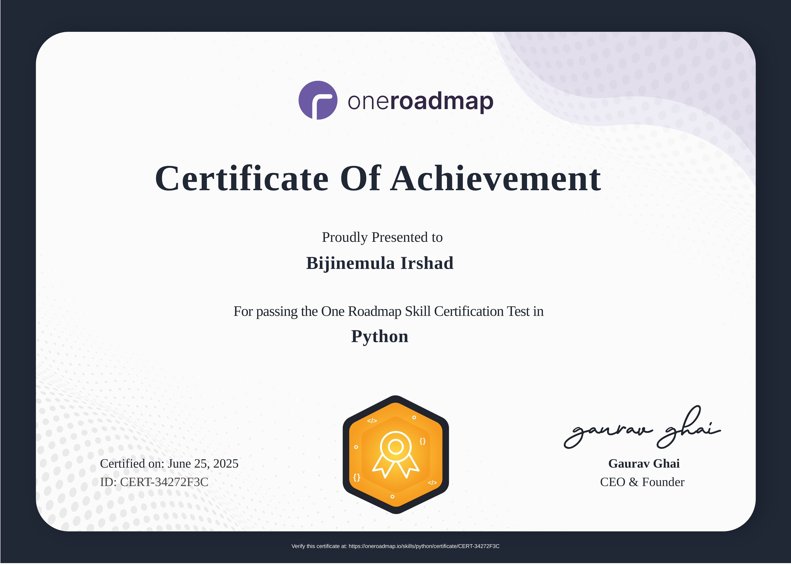

<h1 align="center">Hi 👋, I'm Irshad Bijinemula</h1>
<h3 align="center">Aspiring Data Analyst | SQL & Power BI Enthusiast</h3>

  

---

## 📌 About Me  

- 🎓 Graduted B.Tech student majoring in Mechanical Engineering  
- 📈 Exploring opportunities in data analytics and business intelligence  
- 📊 Skilled in SQL, Python, Excel, Power BI, and data visualization  
- 📬 Email: **irshadbijinemula07@gmail.com**   
- 🔗 [Portfolio Repository](https://github.com/Irshad2601/portfolio-project)  

---

## 💼 Portfolio Projects  

### 🚖 RideIT Driver Engagement Analysis  
Analyzed ride-sharing platform data to assess driver engagement, retention, and performance using SQL.  
- Cleaned and transformed raw data using median imputation and CTEs  
- Built KPIs including **Driver Retention Rate**, **Utilization Rate**, and **Performance Segments**  
- Delivered actionable insights through volume, rating, and cancellation analysis  

🛠 **Tech Used:** SQL (T-SQL), Window Functions, KPIs  
🔗 [GitHub Repository](https://github.com/Irshad2601/portfolio-project/tree/main/rideit)

---

### 💳 Credit Card Customer Churn Analysis  
Explored customer churn behavior for a bank using Python. Delivered insights on why customers leave and how to improve retention.  
- Performed data quality checks and handled missing values/outliers  
- Conducted EDA using `pandas`, `matplotlib`, and `seaborn`  
- Suggested business-focused recommendations based on patterns and trends  

🛠 **Tech Used:** Python, Pandas, Seaborn, Matplotlib  
🔗 [GitHub Repository](https://github.com/Irshad2601/portfolio-project/tree/main/credit%20card%20customer%20churn)

---

## 🛠 Technical Skills  

  
  
  
  
  
  
  

---

## 🏅 Certifications  
### One Roadmap : Data Analyst Certificate 

### One Roadmap : SQL Certificate 

### One Roadmap : Python Certificate 

- 🏆 One Roadmap: Data Analyst 
- 🎓 NPTEL: Intellectual Property Rights & Competition Law  
- 🎓 NPTEL: Operations Management  

---

## 📈 GitHub Stats  

  
  

---

## 🌐 Connect with Me  

    
    
    

---

⭐️ **Thanks for visiting! If you like my work, feel free to star my projects.**
