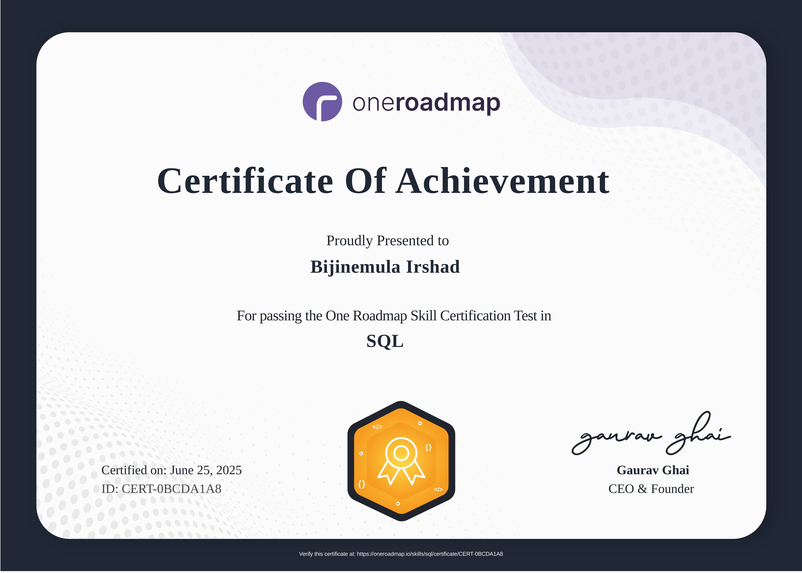

# Hi 👋, I'm Irshad Bijinemula

<h3 align="center">Aspiring Data Analyst | Generative AI & Business Intelligence Enthusiast</h3>

  

---

## 📌 About Me

- 🎓 B.Tech graduate in Mechanical Engineering
- 📈 Interested in Data Analytics, Business Intelligence, and Generative AI
- 🤖 Building practical AI applications using Python, Hugging Face, and Streamlit
- 📊 Experienced in SQL, Python, Excel, Power BI, and data visualization
- ☁️ Familiar with Azure Data Factory, Snowflake, and ETL workflows
- 📬 Email: **irshadbijinemula07@gmail.com**
- 🔗 [Portfolio Repository](https://github.com/Irshad2601/portfolio-project)

---

## 🚀 Featured Project – Generative AI

### 🎫 AI-Powered Customer Support Ticket Assistant

**Business Problem:**

Customer support teams often handle large volumes of incoming tickets. Manually reading each ticket, identifying the issue, assigning priority, summarizing the problem, and drafting responses can be time-consuming and repetitive.

**Solution:**

Developed a Python-based AI application that leverages a pretrained Large Language Model (LLM) from Hugging Face to assist with customer support ticket analysis and response drafting.

**Key Features:**

- 🤖 Integrated the **Qwen3-0.6B** pretrained model from Hugging Face using Transformers.
- 📝 Generates concise summaries of customer support tickets.
- 🏷️ Suggests ticket categories such as Billing, Technical Issue, Account Access, Delivery, and Returns.
- 🚦 Recommends ticket priority levels: Low, Medium, and High.
- 💬 Generates draft customer support responses for human review.
- 📂 Supports CSV-based ticket input and exports analysed results.
- 🖥️ Developed an interactive application using Streamlit.

**Business Value:**

- Reduces repetitive manual ticket-review activities.
- Helps support teams organize and understand incoming requests.
- Provides initial categorization and prioritization suggestions.
- Assists support agents in preparing customer responses.

**Tech Stack:** Python | Hugging Face Transformers | Qwen3-0.6B | Streamlit | Pandas

🔗 **[GitHub Repository – AI Support Ticket Assistant](https://github.com/Irshad2601/ai-support-ticket-assistant)**

---

## 💼 Portfolio Projects

### 🚖 RideIT Driver Engagement Analysis

Analysed ride-sharing platform data to assess driver engagement, retention, and performance using SQL.

- Cleaned and transformed raw data using median imputation and CTEs.
- Developed KPIs including **Driver Retention Rate**, **Utilization Rate**, and **Performance Segments**.
- Delivered business insights through volume, rating, and cancellation analysis.

**Tech Used:** SQL (T-SQL), CTEs, Window Functions, KPIs

🔗 [GitHub Repository](https://github.com/Irshad2601/portfolio-project/tree/main/rideit)

---

### 💳 Credit Card Customer Churn Analysis

Explored customer churn behaviour for a bank using Python to understand customer attrition patterns.

- Performed data quality checks and handled missing values and outliers.
- Conducted Exploratory Data Analysis using Pandas, Matplotlib, and Seaborn.
- Identified customer behaviour patterns and developed business-focused recommendations.

**Tech Used:** Python, Pandas, Seaborn, Matplotlib

🔗 [GitHub Repository](https://github.com/Irshad2601/portfolio-project/tree/main/credit%20card%20customer%20churn)

---

## 🛠 Technical Skills

  
  
  
  
  
  
  
  
  

**Additional Skills:** Data Cleaning | EDA | Data Preprocessing | Data Visualization | ETL | DAX | Power Query | Data Validation

---

## 🏅 Certifications

### One Roadmap – Data Analyst Certificate

### One Roadmap – SQL Certificate

### One Roadmap – Python Certificate

- 🏆 One Roadmap: Data Analyst
- 🎓 NPTEL: Intellectual Property Rights & Competition Law
- 🎓 NPTEL: Operations Management

---

## 📈 GitHub Stats

  
  

---

## 🌐 Connect with Me

  
  
  

---

⭐ **Thanks for visiting! If you like my work, feel free to star my projects.**
